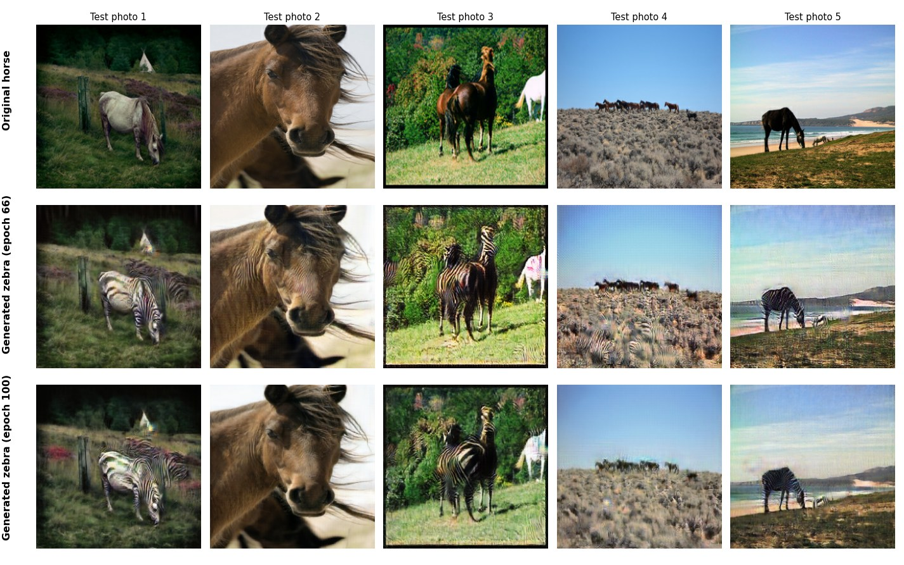
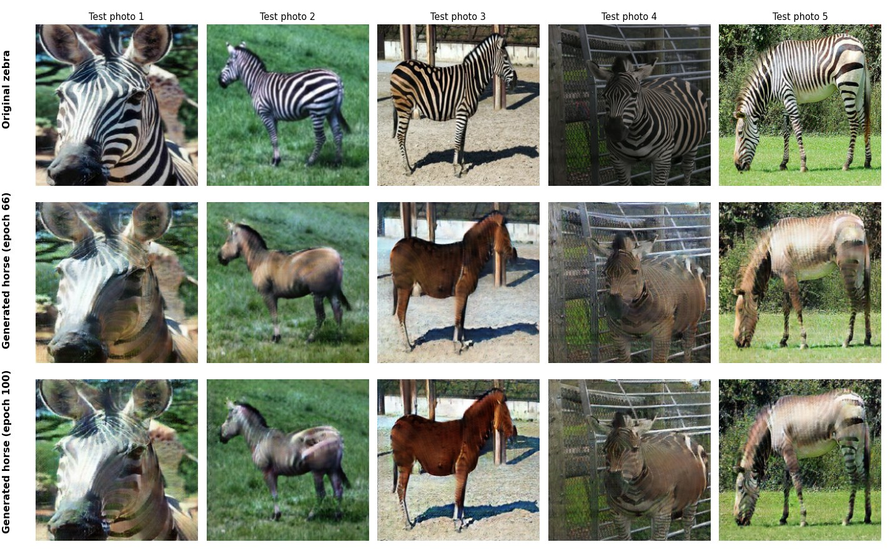
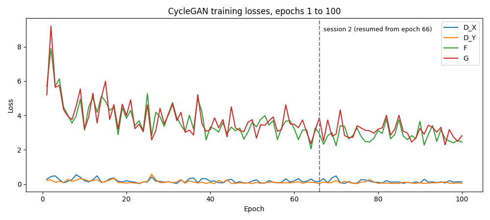

# CycleGAN: Horse ↔ Zebra

Unpaired image-to-image translation with a CycleGAN, implemented in TensorFlow / Keras and trained on the Horse2Zebra dataset. The model never saw a horse and a zebra in the same scene, yet it learns to swap one for the other.

- **Live demo:** https://huggingface.co/spaces/YOUR_HF_USERNAME/cyclegan-horse-zebra
- **Project page:** https://YOUR_GITHUB_USERNAME.github.io/cyclegan-horse2zebra/
- **Model weights:** `G.weights.h5` and `F.weights.h5` (about 46 MB each) are on the Hugging Face Space, not in this repository.

## Results

Test photos the model never saw: the original, the result at epoch 66, and the result at epoch 100. A later epoch is not always better in a GAN.




Training losses over all 100 epochs (dashed line: training was resumed from the epoch 66 checkpoint after the first session ended):



## Method

Two ResNet generators translate in opposite directions (G: horse to zebra, F: zebra to horse) and two 70 x 70 PatchGAN discriminators judge realism. A cycle-consistency loss makes a horse turned into a zebra and back look like the original, so no matched photo pairs are needed.

| Part | Setting |
|---|---|
| Generators | 7x7 conv, 2 downsamples, 9 residual blocks, 2 upsamples, tanh; instance norm, reflection padding |
| Discriminators | 70 x 70 PatchGAN |
| Losses | least-squares adversarial + cycle (weight 10) + identity (weight 5) |
| Optimizer | Adam, learning rate 2e-4, beta1 0.5, batch size 1 |
| Data | Horse2Zebra (1,067 horse and 1,334 zebra training photos, 256 x 256), random crop and flip |
| Training | 100 epochs on a Kaggle T4 GPU in two sessions (epochs 1 to 66, then 67 to 100), about 16 hours in total |

## Run it

**Notebooks** (`notebooks/`)
- `cyclegan_horse2zebra_colab_with_results.ipynb`: the full training code with all results saved in the notebook, so you can read it without running anything.
- `cyclegan_horse2zebra_kaggle.ipynb`: the Kaggle version of the training code.
- `cyclegan_gradio_app.ipynb`: launches the demo app in Colab from saved weights.

**Train locally**
```bash
pip install -r requirements.txt
python train.py          # edit EPOCHS at the top; resumes automatically if a checkpoint exists
```
Training takes roughly 10 minutes per epoch on a T4 GPU. Output goes to `cyclegan_output/` (or set `CYCLEGAN_OUTPUT_DIR`).

**Run the demo app locally**
1. Put `G.weights.h5` and `F.weights.h5` in a `weights/` folder.
2. `python app.py`

The generator accepts any image size. By default your image is used at its own size (up to a limit you choose), with each side a multiple of 4.

## Limitations

- Horse to zebra works best on clear animals in simple scenes. Distant herds and busy backgrounds get smeared stripes.
- Zebra to horse often leaves a faint stripe texture.
- The model was trained at 256 x 256, so very large photos can get finer, patchier stripes.
- The training set is small (about 1,000 photos per side).

## Credits

Based on Zhu, Park, Isola and Efros, [Unpaired Image-to-Image Translation using Cycle-Consistent Adversarial Networks](https://arxiv.org/abs/1703.10593), ICCV 2017. This is an independent re-implementation. The Horse2Zebra dataset comes from the original CycleGAN authors and is used for research; the example images shown here are from its test set.

## License

Add a license of your choice here (for example MIT) before publishing.
